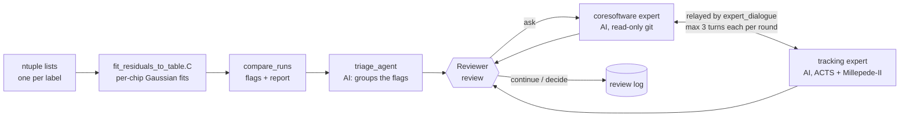

# Silicon Tracking Diagnostics

**Orchestrated AI agents to diagnose detector alignment anomalies** in the
sPHENIX MVTX/INTT silicon tracker.

The framework compares local residual distributions between productions
(alignment iterations, runs, software builds), flags chips and sensors whose
residuals changed, and helps a reviewer investigate **candidate causes** in
sPHENIX `coresoftware`, ACTS and Millepede-II.

What it is: statistical residual comparison with fixed, reproducible
criteria, plus AI agents that group the flags and propose evidence-backed
hypotheses. What it is not: an automatic root-cause finder. The agents
produce candidate causes; a cause is established only when the reviewer
confirms it (for example by rerunning with a commit reverted or an old
alignment file) and records it with `review decide`.

## Architecture



The fit and comparison steps use no AI and never leave the machine. The
triage and the experts are Claude agents. Routing, turn limits and stopping
are fixed Python code (`stdiag/review.py`, `stdiag/expert_dialogue.py`); the
agents never decide which agent runs next, and the reviewer approves every
extra round and makes the final decision.

## Repository layout

```
macros/      ROOT: fit_residuals_to_table.C, plot_fits_overlaid_stavechip.C
stdiag/      Python package: compare_runs, triage_agent, review,
             coresoftware_expert, tracking_expert, expert_dialogue,
             fetch_tracking_docs, paths
maps/        coresoftware_code_map.md, tracking_docs_map.md, labels.example.csv
synthetic/   synthetic fit tables with injected changes, truth check,
             run_test.sh, example reports
tests/       pytest suite (no AI calls)
evals/       evaluation layer for the AI agents (see evals/README.md)
```

## Install and configure

```bash
pip install -e ".[dev]"          # add ",api" for the Anthropic API triage backend
python -m stdiag.fetch_tracking_docs   # ACTS 45.0.0 + Millepede-II snapshot into tracking_docs/
cp maps/labels.example.csv labels.csv  # then fill in per-label configuration
```

The AI steps use the Claude Code CLI (`claude`, logged in). Two locations
can be set with environment variables:

| Variable | Default | Used by |
|---|---|---|
| `STDIAG_CORESOFTWARE` | `../coresoftware` next to this repository | coresoftware and tracking experts |
| `STDIAG_TRACKING_DOCS` | `tracking_docs/` in this repository (git-ignored) | tracking expert |

`coresoftware` is not part of this repository; point the variable at your
checkout (full history needed for the experts).

## Walkthrough

Inputs are given as `list:label` pairs; labels name the productions in every
report.

```bash
# 1. Fits (ROOT, local)
root -b -q 'macros/fit_residuals_to_table.C+("ntuple_list1.txt:Iter0,ntuple_list2.txt:Iter1",".")'

# 2. Comparison (local; the first table is the reference)
python -m stdiag.compare_runs residual_fits_Iter0.csv residual_fits_Iter1.csv

# 3. Triage (AI); --backend api uses an API key instead of the Claude Code login
python -m stdiag.triage_agent flags_Iter0_vs_Iter1.csv summary_Iter0_vs_Iter1.json --backend claude-code

# 4. Review
python -m stdiag.review list     findings_Iter0_vs_Iter1.json
python -m stdiag.review show     findings_Iter0_vs_Iter1.json F1
python -m stdiag.review ask      findings_Iter0_vs_Iter1.json F1     # commits from labels.csv, or --since DATE
python -m stdiag.review continue findings_Iter0_vs_Iter1.json F1 --note "..."   # after a pause
python -m stdiag.review decide   findings_Iter0_vs_Iter1.json F1 accept --note "confirmed by ..."
```

Each report starts with a table of the labels and list files, with a column
for the detector and software configuration behind each one. `--dry-run` on
the triage, `review ask` and `review check` shows exactly what would be sent
without sending it. To look at the distributions:
`root -b -q 'macros/plot_fits_overlaid_stavechip.C+("ntuple_list1.txt:Iter0,ntuple_list2.txt:Iter1","out.pdf",true)'`.

## Fits and flagging criteria

**Fits** (`macros/fit_residuals_to_table.C`): a Gaussian seeded at the peak
bin (half-width: MVTX 15 µm; INTT r-φ 0.2 mm, z 5 mm), refitted twice within
μ ± 2σ so shifted chips are not truncated, by binned Poisson likelihood.
Fewer than 10 entries or 4 populated bins in the window gives `low_stats`.

**Flags** (`stdiag.compare_runs`; every value is a command-line option), per
detector, layer, stave, chip and coordinate:

| Test | Fires when |
|---|---|
| Width | \|(σ₂ − σ₁)/σ₁\| > 0.20 |
| Mean | \|μ₂ − μ₁\| / √(δμ₁² + δμ₂²) > 1.96 **and** \|μ₂ − μ₁\| > minimum shift (MVTX 5 µm; INTT r-φ 20 µm, z 1 mm) |

A chip is flagged if either test fires; entries whose fit is not `ok` in
both inputs are reported as not comparable. The AI never changes these
flags.

**Triage output check** (no AI): every flagged entry must appear in a
finding, and every entry a finding cites must exist in the flags table;
otherwise the report and `findings_*.json` are marked `validation FAILED`.

## The agents

All agents run through the Claude Code CLI (`claude -p`, model
`claude-opus-5-5`) with no edit rights, no MCP connectors, and every tool
outside an explicit list refused (`--permission-mode dontAsk`).

| Agent | Works in | Tools | Reads | Produces |
|---|---|---|---|---|
| Triage | empty temporary folder | none | the comparison data it is given (flagged rows, stave overviews of flagged layers, not-comparable and notable-unflagged entries) | grouped findings with priorities |
| Coresoftware expert | `coresoftware/` | Read, Grep, Glob, read-only git (`log`, `show`, `diff`, `blame`, `status`, ...) | code, history, uncommitted changes, `labels.csv`, code map | ranked hypotheses: commit, file:line, mechanism, test, confidence; or "no code change explains this" |
| Tracking expert | `coresoftware/` + `tracking_docs/` | as above + web fetch limited to www.desy.de, acts-project.github.io, github.com, raw.githubusercontent.com | ACTS 45.0.0 docs and headers, Millepede-II manual, sPHENIX code | per-hypothesis verdict (consistent / partly / inconsistent / cannot verify) with documentation and code citations |

"Notable unflagged" entries (z > 5 but below the minimum shift, width
significance > 4, or fewer than 200 entries) are shown to the triage so it
can mention them; they stay unflagged.

## Orchestration of the expert dialogue

`review ask` starts a dialogue: coresoftware expert turn 1 (its hypotheses),
tracking expert turn 1, coresoftware turn 2, ... at most 3 turns per side
per round. Each expert keeps its own Claude Code session; the orchestrator
passes messages between them and tells each to verify the other's claims.
Every turn ends with a status:

| Status | Effect |
|---|---|
| `continue` | Message relayed to the other expert |
| `converged` | Dialogue ends (only after the tracking expert has taken a turn) |
| `needs_human` | Pauses with a question for you; `review continue --note "answer"` replies to the asking expert |
| limit reached | Pauses with both experts' current positions; `review continue` allows another round of 3 + 3, optionally with a note to both |

State is saved after every turn (`dialogue_*.json`); the transcript is
`dialogue_*.md`; everything the reviewer does is logged in `review_*.json` /
`review_*.md`. `review ask --no-dialogue` gives a single coresoftware expert
answer, and `review check` runs a one-off tracking expert review of any
answer or transcript.

## Tests and CI

```bash
pytest                    # comparison, findings validation, review and dialogue logic (no AI)
synthetic/run_test.sh     # synthetic end-to-end run with truth check (no AI)
```

GitHub Actions (`.github/workflows/ci.yml`) runs both on every push. It
never calls an AI model and needs no credentials.

## Evaluation layer

`evals/` measures the AI agents themselves, one eval per agent, graded by
code wherever possible. See [`evals/README.md`](evals/README.md) for the
plan and status. The first eval (triage) is being set up.

## Versions and references

- **ACTS 45.0.0**: `sPHENIX` branch of `github.com/sPHENIX-Collaboration/acts`,
  commit `2f27de2d0f` (2026-06-01), the version sPHENIX builds against;
  `coresoftware` itself does not pin it. Upstream `main` is a newer API.
- **Millepede-II manual V04-17-06**
  (https://www.desy.de/~kleinwrt/MP2/doc/html/draftman_page.html).
- Refresh the snapshot with
  `python -m stdiag.fetch_tracking_docs [--acts-ref <branch-or-tag>]`;
  provenance is recorded in `tracking_docs/SOURCES.json`.

## Data policy

The fit and comparison steps send nothing anywhere. Each AI step sends its
prompt and whatever the agent reads to Anthropic: fit summaries and labels
for the triage; the finding, code, git history and documentation for the
experts. No ROOT files, hits or tracks are read by any agent. Dialogue
sessions are stored with your Claude Code sessions in `~/.claude/projects/`.
Check whether sending summaries of real sPHENIX data to an external service
is acceptable to the collaboration before using real productions.

## Validation status

Tested:
- **Synthetic end-to-end test** (`synthetic/`): 1312 chip/coordinate rows
  per label with nine known injected changes. The flags match the injected
  truth exactly for two comparisons and 20 random seeds.
- **Blind AI triage** (live, Claude Code backend, earlier prompt version):
  found every flagged injection with no false findings
  (`synthetic/example_reports/`); it could not see the sub-threshold and
  low-statistics chips, which the current prompt now includes.
- **Review and dialogue logic**: pytest with scripted agent replies
  (convergence, turn limit and continuation, questions for the reviewer,
  missing status blocks, file naming).

Not yet run live: `macros/fit_residuals_to_table.C` on real `ntp` files, the
current triage prompt, both experts and their dialogue (including whether
the read-only and web-domain limits hold in practice), and the API backend.

## Limitations

- Gaussian fits are indicative only for INTT z (strip length makes the
  distribution box-like) and hide tail changes.
- Width flags at low statistics are unreliable; check the width-significance
  column.
- Different run conditions (field, luminosity, track momentum spectrum,
  selection, alignment or geometry tag) change widths without any detector
  change.
- Each expert turn takes minutes; a full dialogue round is up to six agent
  runs.
