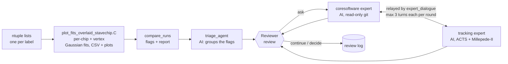

# Silicon Tracking Diagnostics

**Automated chip-by-chip (sensor level for INTT) track residual diagnostics
for different alignment iterations along with an Agentic AI framework for
assisting in root-cause analysis**

The framework compares local residual distributions, and the
track-to-vertex residuals (−DCA_xy, −DCA_z), between productions
(alignment iterations, runs, software builds), flags chips and sensors whose
residuals changed, and helps a reviewer investigate **candidate causes** in
sPHENIX `coresoftware`, ACTS and Millepede-II.

What it is: statistical residual comparison with fixed, reproducible
criteria, plus AI agents that group the flags and propose evidence-backed
hypotheses. What it is not: an automatic root-cause finder. The agents
produce candidate causes; a cause is established only when the reviewer
confirms it (for example by rerunning with a commit reverted or an old
alignment file) and records it with `review decide`.

## Architecture



The fit and comparison steps use no AI and never leave the machine. The
triage and the experts are Claude agents. Routing, turn limits and stopping
are fixed Python code (`stdiag/review.py`, `stdiag/expert_dialogue.py`); the
agents never decide which agent runs next, and the reviewer approves every
extra round and makes the final decision.

## Repository layout

```
macros/      ROOT: plot_fits_overlaid_stavechip.C (fits -> CSV tables, and plots)
stdiag/      Python package: compare_runs, triage_agent, review,
             coresoftware_expert, tracking_expert, expert_dialogue,
             fetch_tracking_docs, paths
maps/        coresoftware_code_map.md, tracking_docs_map.md, labels.example.csv
synthetic/   synthetic data with injected changes: ROOT ntuples
             (make_synthetic_ntp.C) and fit tables, truth check,
             run_full_pipeline.sh, run_test.sh, reference/ outputs,
             example reports; stavechip_demo/ (one stave and one
             ladder, every step by hand)
tests/       pytest suite (no AI calls)
evals/       evaluation layer for the AI agents (see evals/README.md)
inputs/      your residual_fits_<name>.csv tables to compare (local only;
             one synthetic example pair is committed)
runs/        one folder per comparison, <a>_vs_<b> (local only)
```

## Install and configure

```bash
pip install -e ".[dev]"          # add ",api" for the Anthropic API triage backend
python -m stdiag.fetch_tracking_docs   # ACTS 45.0.0 + Millepede-II snapshot into tracking_docs/
cp maps/labels.example.csv labels.csv  # then fill in per-label configuration
```

The AI steps use the Claude Code CLI (`claude`, logged in). Three locations
can be set with environment variables:

| Variable | Default | Used by |
|---|---|---|
| `STDIAG_CORESOFTWARE` | `../coresoftware` next to this repository | coresoftware and tracking experts |
| `STDIAG_TRACKING_DOCS` | `tracking_docs/` in this repository (git-ignored) | tracking expert |
| `STDIAG_RUNS_DIR` | `runs/` in this repository (git-ignored) | `compare_runs`, which creates `<a>_vs_<b>/` folders there |

`coresoftware` is not part of this repository; point the variable at your
checkout (full history needed for the experts).

## Input format

The `macros/plot_fits_overlaid_stavechip.C` macro reads the ROOT files
containing the `ntp` and `track_ntp` trees. They are listed in plain-text list
files, one file name per line, given as `list:label` pairs (e.g.
`ntuple_list1.txt:Iter0,ntuple_list2.txt:Iter1`; the first is the
reference). Each file needs the trees that
`offline/packages/TrackerMillepedeAlignment/MakeMilleFiles.cc` writes.

| Tree | Branches read (all `Float_t`) | Meaning |
|---|---|---|
| `ntp` (required) | `layer`, `stave`, `chip`, `residualX`, `residualY` | One row per cluster. Layers 0–2 are MVTX (stave, chip 0–8), 3–6 INTT (ladder, sensor 0–3); other layers are ignored. `residualX` = local r-φ and `residualY` = local z residual in mm, measurement − fitted state |
| `ntp` (optional) | `track_pt` | Only read with `residualMinimumPtGeV > 0` |
| `track_ntp` (optional) | `residual_vertexX`, `residual_vertexY`, `track_phi`, `track_pt` | One row per track: (−DCA_xy, −DCA_z) in mm, track φ and pT. Written only with the event-vertex constraint on; without it, the VERTEX rows are `low_stats` |

Other branches in the trees are ignored. `synthetic/make_synthetic_ntp.C`
writes exactly these branches and is a working example of the format.

## Walkthrough

Run from the repository root. The fit tables you compare go in `inputs/`;
each comparison gets its own folder, `runs/<a>_vs_<b>/`, which every later
step writes into. Nothing in `inputs/` or `runs/` is committed. Inputs to the
macro are given as `list:label` pairs; labels name the productions in every
report. The commands have no `#` comments, so they paste into zsh as they are.

**1. Fits** (ROOT, local). The macro writes `residual_fits_<label>.csv` per
label into `inputs/` and the plots into the current folder. The first command
makes the CSVs and the plots; the second makes the CSVs only, which is faster.

```bash
root -b -q 'macros/plot_fits_overlaid_stavechip.C+("inputs/ntuple_list1.txt:Iter0,inputs/ntuple_list2.txt:Iter1","residual_fits.pdf",true,true,true,0.0,true,"inputs")'
root -b -q 'macros/plot_fits_overlaid_stavechip.C+("inputs/ntuple_list1.txt:Iter0,inputs/ntuple_list2.txt:Iter1","",false,true,true,0.0,true,"inputs",false)'
```

Keep the list files in `inputs/` too: they hold the paths of your ROOT files.
If you already have the CSV files, skip this step. Any name of the form
`residual_fits_<name>.csv` works.

### Compare your own CSV files

Suppose `plot_fits_overlaid_stavechip.C` (step 1) gave you
`residual_fits_Iter{A}.csv` and `residual_fits_Iter{B}.csv`, for example
`residual_fits_Iter0.csv` and `residual_fits_Iter1.csv`. Put them in the
`inputs/` folder: step 1 writes them there directly; otherwise copy them
there. `Iter{A}` is the reference. Then, from the repository root:

**2. Set the two names once** and check that both files are there.

```bash
cd silicon-tracking-diagnostics
export PYTHONPATH=$PWD
A=0
B=1
RUN=runs/Iter${A}_vs_Iter${B}
ls inputs/residual_fits_Iter$A.csv inputs/residual_fits_Iter$B.csv
```

Any name of the form `residual_fits_<name>.csv` works; with other names,
write `inputs/residual_fits_<name>.csv` in step 3 and `runs/<a>_vs_<b>` for
`RUN`.

**3. Compare (local, no AI).** This creates `$RUN`.

```bash
python -m stdiag.compare_runs inputs/residual_fits_Iter$A.csv inputs/residual_fits_Iter$B.csv
ls $RUN
less $RUN/report_*.md
```

Expect `... N flagged of M comparable (K not comparable)` and three files in
`$RUN`. The files inside are named from the `label` column of each table,
hence the `*` in the commands below. Read both the flagged entries and the
not-comparable list: an entry out of range in one input can hide a large
shift. Running this step again deletes `$RUN` and starts again, including any
triage and review files from the earlier run.

**4. Triage (AI).** First see what would be sent, then run it. The second
command costs about $0.50 on your Claude Code login and sends the flag summary
to Anthropic; check collaboration policy before using real data.
`--backend api` uses an API key instead.

```bash
python -m stdiag.triage_agent $RUN/flags_*.csv $RUN/summary_*.json --backend claude-code --dry-run | less
python -m stdiag.triage_agent $RUN/flags_*.csv $RUN/summary_*.json --backend claude-code
less $RUN/triage_report_*.md
```

The report header must say `validation passed`.

**5. Review.**

```bash
python -m stdiag.review list $RUN/findings_*.json
python -m stdiag.review show $RUN/findings_*.json F1
python -m stdiag.review ask $RUN/findings_*.json F1 --dry-run
python -m stdiag.review ask $RUN/findings_*.json F1
python -m stdiag.review decide $RUN/findings_*.json F1 accept --note "confirmed by ..."
```

`ask` takes the commits from `labels.csv` in the repository root, or from
`--since YYYY-MM-DD`. Until the experts' read-only limits have been tested,
point `STDIAG_CORESOFTWARE` at a throwaway clone of coresoftware. Use
`python -m stdiag.review continue $RUN/findings_*.json F1 --note "..."` to
resume a paused dialogue.

To compare several tables with one reference, list them all after the
reference. Each comparison gets its own `runs/` folder.

#### Example: the committed example pair

`inputs/` also holds two synthetic tables, `residual_fits_example_iter0.csv`
and `residual_fits_example_iter1.csv`: one MVTX stave and one INTT ladder with
known shifts (see `synthetic/stavechip_demo/`). To see what each step gives
before using your own files, run:

```bash
cd silicon-tracking-diagnostics
export PYTHONPATH=$PWD
python -m stdiag.compare_runs inputs/residual_fits_example_iter0.csv inputs/residual_fits_example_iter1.csv
ls runs/example_iter0_vs_example_iter1
less runs/example_iter0_vs_example_iter1/report_example_iter0_vs_example_iter1.md
python -m synthetic.stavechip_demo.check_demo runs/example_iter0_vs_example_iter1/flags_example_iter0_vs_example_iter1.csv
python -m stdiag.triage_agent runs/example_iter0_vs_example_iter1/flags_example_iter0_vs_example_iter1.csv runs/example_iter0_vs_example_iter1/summary_example_iter0_vs_example_iter1.json --backend claude-code --dry-run | less
python -m stdiag.triage_agent runs/example_iter0_vs_example_iter1/flags_example_iter0_vs_example_iter1.csv runs/example_iter0_vs_example_iter1/summary_example_iter0_vs_example_iter1.json --backend claude-code
python -m stdiag.review list runs/example_iter0_vs_example_iter1/findings_example_iter0_vs_example_iter1.json
python -m stdiag.review show runs/example_iter0_vs_example_iter1/findings_example_iter0_vs_example_iter1.json F1
```

What you should get:
- **`compare_runs`** prints `example_iter1 vs example_iter0: 10 flagged of
  57 comparable (3 not comparable)`. `ls` shows `flags_…csv`, `report_…md`
  and `summary_…json`.
- **The report** shows the counts row `60 | 57 | 3 | 10 | 10 | 0 | 0` (rows,
  comparable, not comparable, flagged, mean, width, both).
  - **Flagged:** INTT L3 ladder 0 sensor 2 z, +1457.3 µm; MVTX L0 stave 0
    chip 3 r-φ, +9.3 µm; chip 5 r-φ, −300.8 µm; seven VERTEX dca_xy φ bins
    (0, 1, 2, 7, 8, 9, 10), between +16.5 and −12.3 µm.
  - **Not comparable:** MVTX chip 7 (`low_stats` in both, 2 rows) and chip 8
    r-φ (`out_of_range` in `example_iter0`).
- **`check_demo`** compares these flags with the known truth of the example
  and ends with `PASS`. It only applies to the example, not to your own
  files.
- **The triage dry run** prints what would be sent and ends with `Dry run
  only; nothing was sent.`
- **The live triage** costs about $0.50 and sends this synthetic summary to
  Anthropic. Its report header should say `validation passed`. It should
  treat chips 3 and 5 and INTT sensor 2 as single-chip shifts, make the seven
  φ bins one vertex finding, and put chips 7 and 8 under statistics/coverage
  issues.
- **`review list`** and **`review show`** list the findings and show the
  first one.

Each report starts with a table of the labels and list files, with a column
for the detector and software configuration behind each one. `--dry-run` on
the triage, `review ask` and `review check` shows exactly what would be sent
without sending it.

`macros/plot_fits_overlaid_stavechip.C` fills, fits and writes everything in
one pass, so the CSV tables and the plots always use the same histograms and
the same fit. Its arguments, in order:

| Argument | Default | Meaning |
|---|---|---|
| `listfiles` | `"ntuple_list_short.txt"` | `list:label` pairs, comma-separated |
| `outputPdf` | `"silicon_stavechip_residual_fits.pdf"` | PDF name (PNGs are written next to it) |
| `includeGaussianFit` | `false` | draw the fit (the one written to the CSV) and its μ, σ in the legends |
| `drawHistogramsAsMarkers` | `true` | markers instead of lines |
| `normalizeToUnitArea` | `true` | display only; fits always use raw counts |
| `vertexMinimumPtGeV` | `0.0` | minimum track pT for the track-to-vertex residuals |
| `writeToCsv` | `true` | write `residual_fits_<label>.csv` per label |
| `csvOutputDirectory` | `"."` | where the CSV tables go |
| `makePlots` | `true` | write the PDF and PNGs |
| `residualMinimumPtGeV` | `0.0` | minimum track pT for the MVTX/INTT residuals; needs a `track_pt` branch in `ntp` (MakeMilleFiles does not write one yet), so a cut above 0 without it is an error |

The PDF has two pages per populated stave (local r-φ and local z) and, last,
the track-to-vertex residuals: ⟨−DCA_xy⟩ and ⟨−DCA_z⟩ vs track φ, and the
−DCA distributions.

## Fits and flagging criteria

**Fits** (`macros/plot_fits_overlaid_stavechip.C`; the plot legends show
the same fit with `includeGaussianFit`). Residuals are filled over a
histogram range wider than the plotted range, so a misaligned chip stays
inside it: MVTX ±0.5 mm; INTT r-φ ±3 mm, z ±40 mm (same bin width as the
plots).
- **MVTX, INTT r-φ, VERTEX** (`fit_model = gaus`): a Gaussian seeded at the
  peak bin (half-width: MVTX 15 µm; INTT r-φ 0.2 mm; VERTEX 0.5 mm), refitted
  twice within μ ± 2σ so shifted chips are not truncated, by binned Poisson
  likelihood.
- **INTT z** (`fit_model = box_gaus`): the residual is flat over the 16 or
  20 mm strip, so the fit is a box of length L convolved with a Gaussian of
  width s, plus a flat background for outliers. It is seeded from the mean
  and RMS of the in-range entries and refitted twice within centre ± 0.75 L.
  `mu_mm` is the box centre and `sigma_mm` is the RMS of the fitted shape,
  √(L²/12 + s²), so the width test means the same as for the other rows;
  L and s are in `box_length_mm` and `edge_sigma_mm`.
- **Fit status**: `low_stats` with fewer than 10 entries or 4 populated bins
  in the window (50 and 10 for the box fit); `fit_failed` if the fit does
  not converge or the narrowed window loses its entries; `out_of_range` if
  more than half of the entries are outside the histogram range
  (`n_underflow`, `n_overflow`), so a chip misaligned beyond the range is
  not mistaken for one without data. Only `ok` rows are compared.

**Stave rows.** Every MVTX stave and INTT ladder also gets one row per
coordinate with `chip = −1`: the same fit applied to the sum of all its
chips or sensors (the "combined" panel of the plots). They help tell a
whole-stave shift from a single chip. They are not independent of the chip
rows, are counted separately (level `stave`) in the comparison summary, and
their INTT z rows are only indicative.

**Vertex rows.** If an input's files contain `track_ntp`, every table also
gets `detector=VERTEX` rows from `residual_vertexX/Y` = (−DCA_xy, −DCA_z) in
mm, for tracks with pT ≥ `vertexMinimumPtGeV`. `MakeMilleFiles` writes
`track_ntp` only when the event-vertex constraint is on.
- Keys: `layer = stave = −1`, `coord` = `dca_xy` / `dca_z`. The chip id is
  the track-φ bin: `chip = −1` is all tracks; `chip = 0–13` are 14 equal
  track-φ bins over [−π, π).
- Fit: the Gaussian fit above, over ±2 mm with a ±0.5 mm seed window.
- An input without `track_ntp` gets `low_stats` VERTEX rows and a warning.
- `vertex_phi_fit_<label>.csv` holds the fit of A·sin(φ − φ0) + c to
  ⟨−DCA_xy⟩ vs track φ; A·(cos φ0, sin φ0) is the event vertex minus the
  point the tracks point back to. `compare_runs` does not read it.

**`trunc_mean_mm`, `trunc_mean_err_mm`** (all rows) are the unbinned mean,
and its error, of the entries inside the histogram range (±2 mm for VERTEX;
the chip ranges above). For the VERTEX φ bins these are the ⟨−DCA⟩ points
on the plot page. **`min_pt_gev`** is the track pT cut applied to the row.

**Flags** (`stdiag.compare_runs`; every value is a command-line option), per
detector, layer, stave, chip and coordinate:

| Test | Fires when |
|---|---|
| Width | \|(σ₂ − σ₁)/σ₁\| > 0.20 |
| Mean | \|μ₂ − μ₁\| / √(δμ₁² + δμ₂²) > 1.96 **and** \|μ₂ − μ₁\| > minimum shift (MVTX 5 µm; INTT r-φ 20 µm, z 1 mm; VERTEX dca_xy 10 µm, dca_z 20 µm) |

A chip is flagged if either test fires; entries whose fit is not `ok` in
both inputs are reported as not comparable. The AI never changes these
flags.

**Triage output check** (no AI): every flagged entry must appear in a
finding, and every entry a finding cites must exist in the flags table;
otherwise the report and `findings_*.json` are marked `validation FAILED`.

## The agents

All agents run through the Claude Code CLI (`claude -p`, model
`claude-opus-5-5`) with no edit rights, no MCP connectors, and every tool
outside an explicit list refused (`--permission-mode dontAsk`).

| Agent | Works in | Tools | Reads | Produces |
|---|---|---|---|---|
| Triage | empty temporary folder | none | the comparison data it is given (flagged rows, stave overviews of flagged layers, not-comparable and notable-unflagged entries) | grouped findings with priorities |
| Coresoftware expert | `coresoftware/` | Read, Grep, Glob, read-only git (`log`, `show`, `diff`, `blame`, `status`, ...) | code, history, uncommitted changes, `labels.csv`, code map | ranked hypotheses: commit, file:line, mechanism, test, confidence; or "no code change explains this" |
| Tracking expert | `coresoftware/` + `tracking_docs/` | as above + web fetch limited to www.desy.de, acts-project.github.io, github.com, raw.githubusercontent.com | ACTS 45.0.0 docs and headers, Millepede-II manual, sPHENIX code | per-hypothesis verdict (consistent / partly / inconsistent / cannot verify) with documentation and code citations |

"Notable unflagged" entries (z > 5 but below the minimum shift, width
significance > 4, or fewer than 200 entries) are shown to the triage so it
can mention them; they stay unflagged.

## Orchestration of the expert dialogue

`review ask` starts a dialogue: coresoftware expert turn 1 (its hypotheses),
tracking expert turn 1, coresoftware turn 2, ... at most 3 turns per side
per round. Each expert keeps its own Claude Code session; the orchestrator
passes messages between them and tells each to verify the other's claims.
Every turn ends with a status:

| Status | Effect |
|---|---|
| `continue` | Message relayed to the other expert |
| `converged` | Dialogue ends (only after the tracking expert has taken a turn) |
| `needs_human` | Pauses with a question for you; `review continue --note "answer"` replies to the asking expert |
| limit reached | Pauses with both experts' current positions; `review continue` allows another round of 3 + 3, optionally with a note to both |

State is saved after every turn (`dialogue_*.json`); the transcript is
`dialogue_*.md`; everything the reviewer does is logged in `review_*.json` /
`review_*.md`. `review ask --no-dialogue` gives a single coresoftware expert
answer, and `review check` runs a one-off tracking expert review of any
answer or transcript.

## Tests and CI

```bash
pytest                          # comparison, findings validation, review and dialogue logic,
                                # truth check on synthetic/reference/ (no AI, no ROOT)
synthetic/run_test.sh           # synthetic fit tables -> comparison -> truth check (no AI, no ROOT)
synthetic/run_full_pipeline.sh  # the same from synthetic ROOT files, through the fit macro (needs ROOT)
synthetic/stavechip_demo/run_demo.sh  # one stave + one ladder, current vs old fit settings (needs ROOT)
```

GitHub Actions (`.github/workflows/ci.yml`) runs `pytest` and
`synthetic/run_test.sh` on every push; it has no ROOT, so the full pipeline
is run by hand. CI never calls an AI model and needs no credentials.

## Evaluation layer

The framework is evaluated in three parts. The steps without AI and the code
around the agents are tested against known answers; the AI agents themselves
have an eval in `evals/` that is built but not yet run. Details are in
[Validation status](#validation-status) and [`evals/README.md`](evals/README.md).

| Part | Steps | Criteria | Results |
|---|---|---|---|
| **Steps without AI** (fits, comparison) | Synthetic data with known injected changes → fit macro → `compare_runs` → `check_against_truth` / `check_demo` | Every row's status (flagged, unchanged, not comparable) matches the injected truth; statistically limited rows may go either way | Fit tables: 1312/1312 rows, 2 comparisons, 20 seeds. From ROOT files: 1550/1550 rows, reference seed and seeds 1–8. Stave/chip demo: current fit passes; the old settings fail in the 4 expected entries |
| **Code around the agents** | `pytest` with scripted agent replies (no AI) | Triage output validation (missing or invented entries, invalid groups, no JSON), no truth in the triage prompt, dialogue routing (convergence, turn limits, questions to the reviewer, missing status blocks), run folders | 34 tests pass; they also run in CI |
| **AI triage** (`evals/triage/`) | 21 synthetic cases × 2 repetitions: no change, stave-wide, single chip or sensor, width, mean and width, missing ladder, sub-threshold and low-statistics decoys, two mixed. Each runs the real comparison and the real triage; the runner refuses to start until the reviewer approves a checksum of the harness | Graded by code from `findings_*.json`. A run passes if validation passed, every injected change that produces flags is matched by one finding (≥80% overlap both ways) in the expected group, and there are no invented or merged findings. Recall, group accuracy, cost and time are also recorded | Grader self-test passes on all 21 cases: a perfect answer passes everywhere, and empty or lumped-together answers fail where they should. **The benchmark has not been run yet, so there is no pass rate.** Two earlier live runs on the synthetic Iter1/Iter2 comparisons grouped every injected change correctly; that is too few to quote an accuracy, and 42 runs will still carry about ±15 percentage points |

Evals for the coresoftware expert (finds the causing commit), the tracking
expert (verdicts), the permission limits and the expert dialogue are planned
but not built.

## Try the whole pipeline on synthetic data

No real data is needed. One command makes synthetic ROOT files with known
injected misalignments and runs every step on them:

```bash
pip install -e ".[dev]"            # numpy, pandas, pytest
synthetic/run_full_pipeline.sh     # needs ROOT (root on PATH); ~20 s, nothing leaves the machine
```

| Step | Tool | Output in `synthetic/pipeline_output/` |
|---|---|---|
| 1. Injected truth | `synthetic.make_synthetic_fit_tables` | `injections.csv` |
| 2. Synthetic ROOT files (`ntp` + `track_ntp`) | `synthetic/make_synthetic_ntp.C` | `synth_Iter{0,1,2}.root` (~20 MB each) |
| 3. Per-chip fits | `macros/plot_fits_overlaid_stavechip.C` | `residual_fits_*.csv`, `vertex_phi_fit_*.csv` |
| 4. Comparison | `stdiag.compare_runs` | `flags_*.csv`, `summary_*.json`, `report_*.md` |
| 5. Truth check | `synthetic.check_against_truth` | `truth_check_*.txt` |
| 6. Check against the committed reference | `synthetic.compare_to_reference` | printed |
| 7. Triage dry run (what would be sent) | `stdiag.triage_agent --dry-run` | `triage_dry_run_*.txt` |

Iter0 is the reference, with no injected change. Iter1 has a stave shift, a
broadened chip, chip and sensor shifts, a missing ladder, and two decoys: a
significant shift below the minimum shift, and a low-statistics chip. Iter2
has half of MVTX layer 2 shifted in z. The full list is in
`synthetic/reference/injections.csv`.

Expected result: Iter1 vs Iter0 flags 17 entries (19 not comparable),
Iter2 vs Iter0 flags 105 (9 not comparable), both truth checks print `PASS`,
and step 6 prints `matches the reference` three times. The script exits
non-zero otherwise. See [`synthetic/reference/README.md`](synthetic/reference/README.md).

Options:
- `--plots` also writes the residual plots (`synthetic_residual_fits.pdf`
  and PNGs).
- `--ai-claude-code` also runs the AI triage through your Claude Code login,
  which sends the synthetic flag summary to Anthropic. Then continue with
  `python -m stdiag.review list synthetic/pipeline_output/findings_Iter0_vs_Iter1.json`.

To use your own CSV files, see
[Compare your own CSV files](#compare-your-own-csv-files) above. To start
from your own ROOT files, see the walkthrough, with lists of your ROOT files
in place of the synthetic list files.

### Step-by-step demo: one stave and one ladder (no ROOT needed)

[`synthetic/stavechip_demo/`](synthetic/stavechip_demo/README.md) is small
enough to check every flag by eye. It is one MVTX stave and one INTT ladder
with known shifts, including chips outside the plotted and histogram ranges,
an INTT z sensor shift and a vertex offset. Its fit tables are committed, so
each step runs without ROOT. Run from the repository root (no trailing `#`
comments, so this pastes into zsh):

```bash
export PYTHONPATH=$PWD
D=$PWD/synthetic/stavechip_demo/reference/after
OUT=$PWD/synthetic/stavechip_demo/output/manual
mkdir -p "$OUT"
python3 -m stdiag.compare_runs "$D/residual_fits_Iter0.csv" "$D/residual_fits_Iter1.csv" --out-dir "$OUT"
python3 -m synthetic.stavechip_demo.check_demo "$OUT/flags_Iter0_vs_Iter1.csv" --tables "$D"
python3 -m stdiag.triage_agent "$OUT/flags_Iter0_vs_Iter1.csv" "$OUT/summary_Iter0_vs_Iter1.json" --backend claude-code --dry-run
```

Expected: `10 flagged of 57 comparable (3 not comparable)`, then `PASS`. The
demo README has the truth table, the expected output of every step, the AI
triage and review steps, and a comparison with the old fit settings
(`reference/before/`). With ROOT, `synthetic/stavechip_demo/run_demo.sh`
regenerates everything from `make_synth.C`.

## Versions and references

- **ACTS 45.0.0**: `sPHENIX` branch of `github.com/sPHENIX-Collaboration/acts`,
  commit `2f27de2d0f` (2026-06-01), the version sPHENIX builds against;
  `coresoftware` itself does not pin it. Upstream `main` is a newer API.
- **Millepede-II manual V04-17-06**
  (https://www.desy.de/~kleinwrt/MP2/doc/html/draftman_page.html).
- Refresh the snapshot with
  `python -m stdiag.fetch_tracking_docs [--acts-ref <branch-or-tag>]`;
  provenance is recorded in `tracking_docs/SOURCES.json`.

## Data policy

The fit and comparison steps send nothing anywhere. Each AI step sends its
prompt and whatever the agent reads to Anthropic: fit summaries and labels
for the triage; the finding, code, git history and documentation for the
experts. No ROOT files, hits or tracks are read by any agent.

What Anthropic does with the data depends on how each step authenticates:

| Step | Authentication | Used for training | Kept by Anthropic |
|---|---|---|---|
| `triage_agent --backend api` (default) | API key (commercial terms) | No, unless your organization joins the Development Partner Program | 30 days |
| `triage_agent --backend claude-code` | Claude Code login | Free/Pro/Max: only if "Help improve Claude" is on; Team/Enterprise: no | Free/Pro/Max: 5 years if on, 30 days if off; Team/Enterprise: 30 days |
| `review ask`, `continue`, `check` (both experts) | Claude Code login | As above | As above |

On a Free, Pro or Max plan, turn off "Help improve Claude" at
https://claude.ai/settings/data-privacy-controls; the setting covers Claude
Code too. Opting out only stops training: the data is still sent and kept
for 30 days.

Locally, expert dialogue sessions are stored in plaintext in
`~/.claude/projects/` for 30 days by default (`cleanupPeriodDays` in the
Claude Code settings). The triage, `review ask --no-dialogue` and
`review check` run with `--no-session-persistence` and store no session.

To send as little else as possible, add this to `~/.claude/settings.json`.
User-level settings also reach the `claude -p` runs that the pipeline
starts; restart Claude Code after changing them.

```json
"env": {
  "DISABLE_FEEDBACK_COMMAND": "1",
  "CLAUDE_CODE_DISABLE_FEEDBACK_SURVEY": "1",
  "CLAUDE_CODE_DISABLE_NONESSENTIAL_TRAFFIC": "1"
},
"feedbackDrafts": "off"
```

These block `/feedback`, `/bug` and `/share` (which upload the conversation,
kept for 5 years), the session survey and its transcript-sharing follow-up,
usage metrics and error reports, and Claude-drafted feedback reports. They
do not stop the agents' prompts from being sent, and the tracking expert's
web fetches still send each hostname to `api.anthropic.com` for a safety
check.

Source: https://code.claude.com/docs/en/data-usage (checked 2026-10-04).

## Validation status

Tested:
- **Synthetic end-to-end test** (`synthetic/`): 1312 chip/coordinate rows
  per label with nine known injected changes. The flags match the injected
  truth exactly for two comparisons and 20 random seeds.
- **Full pipeline from synthetic ROOT files** (`synthetic/run_full_pipeline.sh`):
  the same nine injections as `ntp`/`track_ntp` clusters (full MVTX/INTT
  geometry, INTT z as 16/20 mm strip boxes) through the fit macro,
  comparison and truth check. All 1550 rows per label (chip, whole-stave
  and VERTEX) match the injected truth for both comparisons, for the
  reference seed and seeds 1–8. Two runs gave byte-identical tables.
  A few rows are accepted either way because they are statistically limited
  or are stave rows with only some chips changed (see
  `synthetic/check_against_truth.py`).
- **Blind AI triage** (live, Claude Code backend, earlier prompt version):
  found every flagged injection with no false findings
  (`synthetic/example_reports/`); it could not see the sub-threshold and
  low-statistics chips, which the current prompt now includes.
- **Review and dialogue logic**: pytest with scripted agent replies
  (convergence, turn limit and continuation, questions for the reviewer,
  missing status blocks, file naming).
- **Vertex residuals** (synthetic `ntp` + `track_ntp`):
  - The macro compiles (ACLiC, `-Wall -Wextra`). An injected 50 µm sin φ
    −DCA_xy modulation and a 0.1 mm −DCA_z offset are recovered on the plot
    and in the CSV.
  - The CSV truncated means match a TProfile to 10⁻¹⁰ mm.
  - Before the wider histogram ranges, `out_of_range` and the INTT z box
    fit were added, the CSV tables were byte-identical to those of the
    former separate fit macro (`fit_residuals_to_table.C`), with and without
    plots. The legend μ and σ equal the CSV values.
  - `compare_runs` flags an injected 40 µm sin φ offset in 12 of 14 φ bins,
    and not in the integrated row.
- **Stave/chip fits** (`synthetic/stavechip_demo/`, one synthetic stave
  and ladder with known shifts, old vs new fit settings on the same input;
  `check_demo.py` checks every row and both vertex fits):
  - The INTT z box fit finds the +1.5 mm sensor shift (+1.46 mm, z = 24)
    and returns strip lengths of 20.06/15.93/16.05/19.99 mm for 20/16/16/20;
    the old Gaussian fit missed it and flagged two unshifted sensors.
  - A chip at +300 µm (outside the plotted range) is now fitted and flagged
    (−300.8 µm) instead of being `low_stats`; a chip at +800 µm (outside
    the histogram range) is `out_of_range`.
  - The +10 µm MVTX chip shift is found (+9.3 µm) in both versions.

Not yet run live: the vertex page and VERTEX rows on real `track_ntp`,
`macros/plot_fits_overlaid_stavechip.C` on real `ntp` files, the INTT z box
fit and `out_of_range` on real `ntp` files, the
current triage prompt, both experts and their dialogue (including whether
the read-only and web-domain limits hold in practice), and the API backend.

## Limitations

- INTT z uses a box-convolved-with-Gaussian fit, tested only on synthetic
  boxes; INTT z stave rows sum boxes of two lengths and are only indicative.
  Core fits hide changes in the tails.
- Width flags at low statistics are unreliable; check the width-significance
  column.
- Different run conditions (field, luminosity, track momentum spectrum,
  selection, alignment or geometry tag) change widths without any detector
  change.
- VERTEX residuals are biased toward zero, because the vertex is fitted from
  the same tracks.
- The VERTEX φ bins and `chip = −1` share tracks, so they aren't independent.
- A transverse silicon-to-vertex offset shows up as a sinusoid in φ, which
  can cancel in `chip = −1`.
- Track φ is the momentum azimuth at the perigee. With `m_forceSiOnlyFit` and
  `m_siOnlyTpcSeedPt` both on, it comes from the TPC seed.
- Each expert turn takes minutes; a full dialogue round is up to six agent
  runs.
